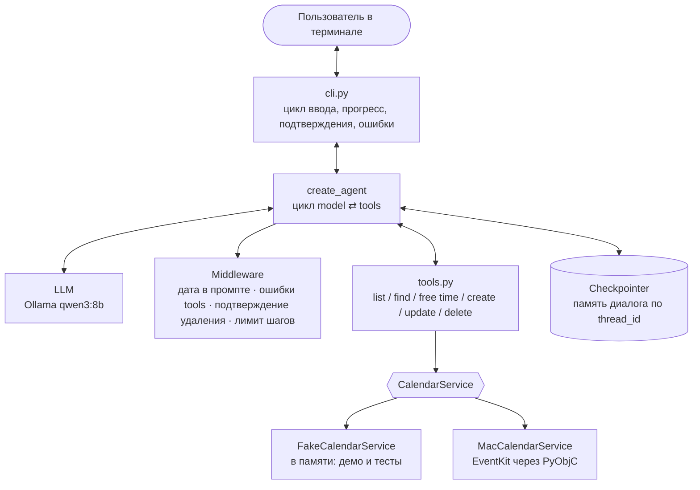

# AI Calendar Manager

[](https://github.com/statiqq-dev/AI-calendar-manager/actions/workflows/tests.yml)


Консольный AI-агент, который ведёт Календарь macOS по обычным фразам на русском:
«поставь созвон с Лёшей в пятницу в 15:00», «что у меня завтра?», «перенеси стоматолога на 17:00».
Работает на локальной модели через Ollama: бесплатно, данные не уходят в облако.

## Что умеет

- **Показывает события** за день, неделю или любой период.
- **Находит событие по названию** с учётом падежей и «ё»: «стоматолога» найдёт «Стоматолог».
- **Ищет свободное время**: «найди свободный час в понедельник».
- **Создаёт события.** Если длительность не названа, ставит 1 час и говорит об этом.
- **Переносит и переименовывает.** При переносе сохраняет длительность.
- **Удаляет только после подтверждения** человеком: агент встаёт на паузу и спрашивает `[y/n]`.
- **Предупреждает о пересечениях** с уже запланированными событиями.
- **Переспрашивает, а не угадывает.** На «запиши меня к стоматологу» спросит день и время.
- **Помнит разговор**: «что у меня завтра?» → «удали его».
- **Не трогает остальные календари**: работает только в отдельном календаре «AI Agent».

## Пример

```text
> что у меня завтра?
  · смотрю календарь…
Завтра, вт 20.10: «Стоматолог» 14:00–15:00.

> перенеси его на 17
  · меняю событие…
Перенёс «Стоматолог» на вт 20.10, 17:00–18:00.

> поставь созвон с Лёшей завтра в 17:30
  · создаю событие…
Создал «Созвон с Лёшей»: вт 20.10, 17:30–18:30. Длительность не была указана, поставил 1 час.
Внимание: пересекается со «Стоматолог» 17:00–18:00.

> запиши меня в спортзал
Во сколько и в какой день?

> удали стоматолога
  · ищу событие…
  · готовлю удаление…
Удалить «Стоматолог» 20.10.2026 17:00–18:00? [y/n] y
Удалил «Стоматолог».
```

## Как устроено



Агент — это цикл: модель получает историю диалога и описания инструментов,
решает, какой инструмент вызвать, получает результат и так до финального ответа.
Цикл даёт `create_agent` из LangChain (под капотом граф LangGraph),
а поведение настраивается через middleware, без ручного графа.

## Ключевые решения

| Решение | Почему |
|---|---|
| **Локальная модель через Ollama** | Бесплатно и приватно. Модель меняется в `.env`, код не трогается. |
| **Дата приходит в системный промпт** (`@dynamic_prompt`) | Модель 8B плохо считает дни недели. Свежая дата и календарь на две недели в каждом запросе убирают целый класс ошибок и лишний вызов инструмента. |
| **Детерминированное — в коде, а не в промпте** | Длительность по умолчанию, перенос с сохранением длительности, свободные окна и пересечения считает Python. Промпт отвечает только за понимание фразы. |
| **Удаление через Human-in-the-Loop** | Необратимое действие выполняет только человек. Пауза встроена в граф агента, а не в текст ответа, поэтому модель не может её обойти. |
| **Ошибки tools возвращаются модели текстом** (`ToolErrorMiddleware`) | Модель видит «событие не найдено» и исправляется сама. Неожиданные ошибки не скрываются и падают громко. |
| **Лимит шагов на запрос** | Если модель зациклилась, пользователь получает понятное сообщение, а не бесконечное ожидание. |
| **Календарь за интерфейсом `CalendarService`** | Агент не знает про EventKit. Фейк в памяти позволяет разрабатывать и тестировать без Mac, а одни и те же контрактные тесты гоняются на обеих реализациях. |
| **Отдельный календарь «AI Agent»** | Ошибка модели не заденет личные события. |
| **Проверки до старта** | Если Ollama не запущена, модель не скачана или нет доступа к Календарю, программа говорит, что сделать, вместо трейсбека. |

## Быстрый старт

Нужны [uv](https://docs.astral.sh/uv/) и [Ollama](https://ollama.com).

```bash
git clone https://github.com/statiqq-dev/AI-calendar-manager.git
cd AI-calendar-manager
ollama pull qwen3:8b        # ~5 ГБ, один раз
cp .env.example .env
uv run calendar-agent
```

По умолчанию включён **демо-календарь в памяти**: можно попробовать агента на любой ОС,
события пропадут после выхода.

### Подключить Календарь macOS

1. В приложении **Календарь** создай календарь **AI Agent** (Файл → Новый календарь).
2. В `.env` поставь `CALENDAR_BACKEND=macos`.
3. Запусти `uv run calendar-agent` из **Terminal.app** или iTerm и разреши доступ к Календарю.

Доступ macOS выдаёт приложению, из которого запущен терминал. Встроенный терминал VS Code
может не показать запрос: тогда запусти из Terminal.app или включи доступ вручную в
«Системные настройки → Конфиденциальность и безопасность → Календари».

### Команды в чате

| Команда | Что делает |
|---|---|
| `/help` | примеры фраз |
| `/new` | начать разговор заново (календарь не меняется) |
| `/exit`, `выход`, Ctrl+D | выход |

### Другая модель

Любая модель с поддержкой tool calling. В `.env`:

```bash
MODEL_NAME=qwen3:14b                    # другая модель Ollama: сначала ollama pull
# или Claude:
# uv add langchain-anthropic
# MODEL_PROVIDER=anthropic
# MODEL_NAME=claude-sonnet-5-5
# ANTHROPIC_API_KEY=sk-ant-...
```

## Тесты

```bash
uv run pytest                                            # быстрые тесты без LLM и без Mac
RUN_MACOS_TESTS=1 uv run pytest                          # + контрактные тесты на настоящем Календаре
RUN_LLM_TESTS=1 uv run pytest tests/test_scenarios_llm.py -v   # сценарии с настоящей моделью
uv run ruff check src tests && uv run mypy src           # линтер и типы
```

- **Unit-тесты** проверяют tools, память, паузу перед удалением, обработку ошибок и CLI.
  Вместо LLM в них фейковая модель с заготовленными ответами.
- **Контрактные тесты** одинаковы для фейка и macOS-реализации. На Mac им нужен
  отдельный пустой календарь **AI Agent Tests**.
- **Сценарии с LLM** — маленький eval: реальная модель, фейковый календарь,
  проверяется итог в календаре («после „перенеси стоматолога на 17“ событие стоит на 17:00»).

## Трейсинг в LangSmith

Каждый шаг агента (вызовы модели, инструментов, паузы) можно смотреть в
[LangSmith](https://smith.langchain.com). Для этого в `.env`:

```bash
LANGSMITH_TRACING=true
LANGSMITH_API_KEY=lsv2_...
LANGSMITH_PROJECT=calendar-agent
```

Код менять не нужно. Учти, что тексты запросов и события календаря уйдут в облако LangSmith.

<!-- Сюда скриншот трейса: docs/langsmith-trace.png и ссылка на публичный трейс -->

## Структура

```text
src/calendar_agent/
├── cli.py              # точка входа: чат в терминале, подтверждения, ошибки
├── config.py           # настройки из .env (pydantic-settings)
├── ai/
│   ├── agent.py        # create_agent + системный промпт + middleware
│   ├── tools.py        # инструменты для модели
│   └── llm.py          # создание модели и проверка Ollama
└── calendar/
    ├── base.py         # интерфейс CalendarService
    ├── models.py       # Event (Pydantic)
    ├── exceptions.py   # ошибки слоя календаря
    ├── fake.py         # календарь в памяти
    └── macos.py        # Календарь macOS через EventKit
tests/                  # unit, контрактные и LLM-сценарии
```

## Ограничения

- Повторяющиеся события, приглашения и напоминания не поддерживаются.
- Память диалога живёт до выхода из программы.
- Модель 8B иногда ошибается в сложных формулировках. Поэтому удаление требует
  подтверждения, а после любого изменения агент называет итоговые дату и время.
